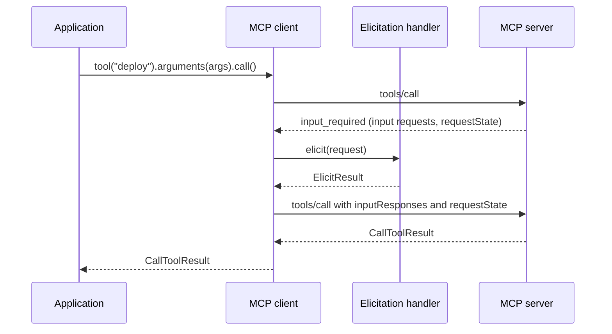
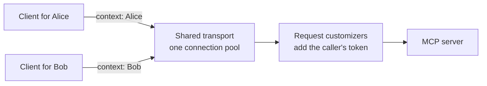

# MCP Client (2026-07-28)

!!! note
    The modern client is available since 2.2.0. Its API, in the `io.modelcontextprotocol.modern` packages,
    may change in minor releases until 3.0, and [some parts of the revision](#not-yet-supported) are not
    implemented. For servers of earlier revisions, use the [classic client](client.md).

## Overview

The modern client talks to servers of the stateless
[2026-07-28 MCP specification revision](https://modelcontextprotocol.io/specification/2026-07-28).
It lives in `io.modelcontextprotocol.modern.client`, next to the classic client, and shares no types with it:
it has its own `McpClient`, its own `McpSchema`, and its own transports. Both ship in `mcp-core`, so no extra
dependency is needed.

The 2026-07-28 revision removes sessions and the `initialize` handshake. Every request carries the protocol
version and the client's capabilities in its `_meta`. The modern client is built around that:

- **Nothing to initialize.** Building a client does no I/O. The first request goes out when the first call
  starts.
- **One client per user.** A client stands for one identity. It is cheap to create, so an application that
  serves several users creates one client per user. See [Identity and Authorization](#identity-and-authorization).
- **Shared transports.** A transport keeps no state about calls. Many clients can share one transport, and so
  one connection pool. A client does not own its transport; whoever created the transport closes it.
- **Immutable request specs.** Each operation starts from a spec, for example
  `client.tool("echo").arguments(args).call()`. Every setter returns a new spec, so a configured spec can be
  kept and reused.
- **The protocol details are handled for you.** The client adds the `_meta` block, negotiates the protocol
  version, answers the server's input requests, and sets the `Mcp-*` headers.

### Classic or modern?

| | [Classic client](client.md) | Modern client |
|---|---|---|
| Package | `io.modelcontextprotocol.client` | `io.modelcontextprotocol.modern.client` |
| Spec revision | 2025-11-25 and earlier | 2026-07-28 |
| Startup | `initialize()` handshake | None |
| Sessions | Yes | No |
| Elicitation | Server-to-client request | Input request answered in a retry of the call |
| Sampling, roots | Supported | Not supported |
| Logging | Supported | Not supported (deprecated by the revision) |

The modern client only speaks the 2026-07-28 protocol version. It cannot call servers that expect an
`initialize` handshake.

## Quick Start

A synchronous client that lists the server's tools and calls one over HTTP:

```java
import java.util.Map;

import io.modelcontextprotocol.modern.McpSchema.CallToolResult;
import io.modelcontextprotocol.modern.McpSchema.Implementation;
import io.modelcontextprotocol.modern.McpSchema.Tool;
import io.modelcontextprotocol.modern.client.McpClient;
import io.modelcontextprotocol.modern.client.McpSyncClient;
import io.modelcontextprotocol.modern.client.transport.HttpClientMcpTransport;

HttpClientMcpTransport transport = HttpClientMcpTransport.builder("http://localhost:8080/mcp").build();

McpSyncClient client = McpClient.sync(transport)
    .clientInfo(Implementation.builder("my-client", "1.0.0").build())
    .build();

for (Tool tool : client.listTools().list().tools()) {
    System.out.println(tool.name());
}

CallToolResult result = client.tool("echo")
    .arguments(Map.of("text", "Hello"))
    .call();
System.out.println(result.content());
```

Clients are immutable and thread-safe. There is nothing to start and nothing to close on the client.

Builder options:

| Method | Purpose |
|---|---|
| `clientInfo(Implementation)` | The client's name and version, sent in `_meta` of every request. Optional, but recommended. |
| `roundTimeout(Duration)` | Timeout of one network exchange. Defaults to 20 seconds. See [Timeouts](#timeouts). |
| `callTimeout(Duration)` | Bound on a whole call. None by default. See [Timeouts](#timeouts). |
| `formElicitation(...)` / `urlElicitation(...)` | Handlers that answer the server's input requests. See [Elicitation](#elicitation). |
| `progress(...)` | Listener for progress notifications. See [Progress](#progress). |
| `transportContextProvider(Supplier)` | Sync only. The identity of each call. See [Identity and Authorization](#identity-and-authorization). |
| `maxInputRounds(int)` | How many times a call answers input requests before it fails. Defaults to 10. |
| `maxListPages(int)` | How many pages a listing of all pages reads before it fails. Defaults to 100. |
| `jsonMapper(McpJsonMapper)` | JSON mapper. Defaults to `McpJsonDefaults.getMapper()`. |

## Transports

### Streamable HTTP

`HttpClientMcpTransport` uses the JDK `HttpClient`. Every request is a POST to the MCP endpoint, answered with
one JSON response or with an event stream scoped to that request. Waiting for an answer holds no thread.

```java
HttpClientMcpTransport transport = HttpClientMcpTransport.builder("https://example.com/mcp")
    .connectTimeout(Duration.ofSeconds(5))
    .customizeClient(http -> http.sslContext(sslContext))
    .build();
```

| Method | Purpose |
|---|---|
| `connectTimeout(Duration)` | How long establishing a connection may take. Defaults to 10 seconds. |
| `customizeClient(Consumer<HttpClient.Builder>)` | Customize the `HttpClient`, for example its executor or SSL context. |
| `clientBuilder(HttpClient.Builder)` | Replace the `HttpClient` builder. HTTP/1.1 is used by default. |
| `requestCustomizer(McpHttpRequestCustomizer)` | Add headers to each request. Customizers run in the order they were added. |
| `authorizationErrorHandler(McpHttpAuthorizationErrorHandler)` | Decide whether a request answered with `401` or `403` is sent again. |
| `maxResponseSize(int)` | Maximum bytes of one response body or one streamed event. Defaults to 16 MiB. |
| `jsonMapper(McpJsonMapper)` | JSON mapper. Defaults to `McpJsonDefaults.getMapper()`. |

!!! note
    Set the connect timeout with `connectTimeout(...)` on the transport builder. A connect timeout set on the
    `HttpClient` builder through `customizeClient` or `clientBuilder` is replaced by the transport's value.

### STDIO

`StdioMcpClientTransport` runs the server as a process and exchanges newline-delimited JSON-RPC over its
standard streams.

```java
import io.modelcontextprotocol.client.transport.ServerParameters;
import io.modelcontextprotocol.modern.client.transport.StdioMcpClientTransport;

ServerParameters params = ServerParameters.builder("java")
    .args("-jar", "my-mcp-server.jar")
    .build();

try (StdioMcpClientTransport transport = StdioMcpClientTransport.builder(params).start()) {
    McpSyncClient client = McpClient.sync(transport).build();
    // use the client
}
```

`start()` spawns the process. Clients never start or close the transport they are given, so one process can
serve several clients; close the transport once they are done. When the server's output ends or the transport
is closed, every open call fails with `McpResponseLostException`.

`StdioMcpClientTransport.builder(InputStream, OutputStream)` runs over streams that are already connected,
such as a socket's.

### Custom Transports

Other transports implement `McpClientTransport`. Its single method, `exchange(McpTransportRequest)`, sends one
request and emits the server's notifications followed by exactly one response.

An HTTP transport built on another HTTP client can reuse the SDK's building blocks:
`McpHttpRequestHeaders.forRequest(request)` returns the headers the revision requires,
`request.withRoundTimeout(...)` applies the round timeout to one attempt, and `McpHttpRequest.builder(...)`
and `McpHttpResponseInfo.of(...)` create the values the request customizers and the authorization error
handler receive.

## Sync and Async

`McpClient.sync(transport)` builds an `McpSyncClient`, and `McpClient.async(transport)` builds an
`McpAsyncClient`. Both offer the same operations.

- **Sync** calls run on the calling thread and return the result. Elicitation handlers run on that thread too.
- **Async** calls return a `Mono` (or a `Flux` for listen streams). Nothing is sent before subscription.
  Handlers return a `Mono` and must not block.

```java
McpAsyncClient client = McpClient.async(transport).build();

client.tool("echo")
    .arguments(Map.of("text", "Hello"))
    .call()
    .subscribe(result -> System.out.println(result.content()));
```

The examples on this page use the sync client unless they say otherwise.

## Calling the Server

| Operation | Spec | Terminal |
|---|---|---|
| Call a tool | `client.tool(name)` or `client.tool(Tool)` | `call()` |
| Read a resource | `client.resource(uri)` | `read()` |
| Get a prompt | `client.prompt(name)` | `get()` |
| Complete an argument | `client.completion(ref, argument, value)` | `complete()` |
| List one page | `client.tools()`, `prompts()`, `resources()`, `resourceTemplates()` | `list()` |
| List all tools | `client.listTools()` | `list()` |
| Discover the server | | `client.discover()` |
| Listen for changes | `client.listen()` | `open(listener)` (sync), `events()` (async) |

```java
ReadResourceResult resource = client.resource("file:///config.json").read();

GetPromptResult prompt = client.prompt("greeting")
    .arguments(Map.of("name", "Ada"))
    .get();

CompleteResult completion = client.completion(new PromptReference("greeting"), "name", "A").complete();
List<String> suggestions = completion.completion().values();
```

A tool failure the model should see is not an exception. It is a `CallToolResult` whose `isError()` is `true`.

### Per-Call Settings

A spec starts from the client's settings. Each setter replaces one of them for that call only:

```java
CallToolResult result = client.tool("generate_report")
    .arguments(Map.of("year", 2026))
    .roundTimeout(Duration.ofMinutes(5))
    .progress(progress -> System.out.println(progress.message()))
    .meta(Map.of("com.example/traceId", traceId))
    .call();
```

`meta(...)` adds entries to the request's `_meta`. It rejects `progressToken` and keys starting with
`io.modelcontextprotocol/`, which the client sets itself.

### Listing and Pagination

The list specs return one page. Pass the previous page's `nextCursor()` to read the next one:

```java
String cursor = null;
do {
    ListResourcesResult page = client.resources().cursor(cursor).list();
    page.resources().forEach(resource -> System.out.println(resource.uri()));
    cursor = page.nextCursor();
}
while (cursor != null);
```

For tools, `client.listTools().list()` reads all pages and returns them as one result.

### The Kept Tool Listing

The client keeps the result of `listTools().list()` for as long as the server's `ttlMs` allows, and returns
it without asking the server again.

- `client.listTools().skipCache().list()` always asks the server and keeps the new listing.
- `client.tools().list()`, which reads one page, always asks the server.
- A listing with a `ttlMs` of `0` is not kept.
- A [listen stream](#change-notifications) that tracks tool changes drops the kept listing when the tools
  change.
- A listing the server marks as `private` is kept too, because a client stands for one user.

### Server Discovery

`client.discover()` returns the server's supported versions, capabilities and instructions. The result is kept
for its `ttlMs`.

```java
DiscoverResult server = client.discover();
ServerCapabilities capabilities = server.capabilities();
Object serverInfo = server.meta() != null ? server.meta().get(McpSchema.MetaKeys.SERVER_INFO) : null;
```

The server's name and version are not a field of the result. Servers send them in `_meta`, under
`io.modelcontextprotocol/serverInfo`, as an untyped map. A server may leave `_meta` out, so check for `null`.

## Timeouts

| Timeout | Bounds | Default |
|---|---|---|
| Round timeout | One network exchange: from sending a request until its response arrives. | 20 seconds |
| Call timeout | The whole call: every exchange, every handler and every wait. | None |

- Progress notifications do not extend the round timeout. A tool that runs longer than the round timeout
  fails unless you raise it, on the builder or on the call's spec.
- The call timeout includes the time a user takes to answer an elicitation, so a slow user fails the call.
  Use it where a hard deadline matters more, for example in unattended jobs.
- Listen streams have no timeout.

A timeout fails the call with `McpTimeoutException`, whose `kind()` is `ROUND` or `CALL`. The request may
have reached the server, so its outcome is unknown. The client never retries it.

## Elicitation

The 2026-07-28 revision has no server-to-client requests. A server that needs input from the user answers a
`tools/call`, `resources/read` or `prompts/get` with an `input_required` result. The client asks its handlers
and sends the request again with the answers, until the server completes it. See
[Multi Round-Trip Requests](server-modern.md#multi-round-trip-requests) for the server side.



The application makes one call and gets one result. The rounds in between are the client's job.

```java
McpSyncClient client = McpClient.sync(transport)
    .formElicitation(request -> {
        String name = askUser(request.message(), request.requestedSchema());
        return name != null ? ElicitResult.accept(Map.of("name", name)) : ElicitResult.decline();
    })
    .urlElicitation(request -> {
        boolean opened = askConsentAndOpenBrowser(request.message(), request.url());
        return opened ? ElicitResult.accept(Map.of()) : ElicitResult.decline();
    })
    .build();
```

- **Form mode.** The handler receives an `ElicitFormRequest` with a message and a JSON schema, and returns
  the user's answer.
- **URL mode.** The handler receives an `ElicitUrlRequest`. Ask the user for consent, open the URL, and
  return right away. The server learns from the browser when the user is done. The request that follows an
  accepted URL elicitation has no round timeout, because the server may hold it open until then.
- **Per call.** `formElicitation(...)` and `urlElicitation(...)` on a tool, resource or prompt spec replace
  the client's handler for that call.
- **Capabilities follow the handlers.** Each request declares the `elicitation` capability for exactly the
  modes that have a handler. A client without handlers declares none.
- **Threads.** A sync handler runs on the thread that made the call. A timeout cannot interrupt it; the call
  timeout is checked when the handler returns. An async handler returns a `Mono`, which is cancelled when the
  call ends without its answer; close any pending dialog then.

A call answers input requests at most `maxInputRounds` times (10 by default) and then fails with
`McpInputRoundsExceededException`.

### Running the Rounds Yourself

`callOnce()`, `readOnce()` and `getOnce()` send the request once and return the server's answer as it is:
the final result or an `InputRequiredResult`. Use them to pause a call, for example until a user answers in a
later HTTP request, and continue it with `inputResponses(...)` and `requestState(...)`:

```java
McpSyncClient.ToolSpec deploy = client.tool("deploy").arguments(Map.of("env", "prod"));

CallToolOutcome outcome = deploy.callOnce();
if (outcome instanceof InputRequiredResult inputRequired) {
    Map<String, Object> responses = new LinkedHashMap<>();
    inputRequired.inputRequests().forEach((key, request) -> responses.put(key, answer(request)));

    CallToolResult result = deploy
        .inputResponses(responses)
        .requestState(inputRequired.requestState())
        .call();
}
```

Key the answers as the server keyed its requests, and send `requestState` back as it was received.

## Progress

A progress listener receives the `notifications/progress` of a call. Set one for every call on the builder,
or for one call on its spec:

```java
McpSyncClient client = McpClient.sync(transport)
    .progress(progress -> System.out.println(progress.progress() + " / " + progress.total()))
    .build();
```

- The client asks the server for progress only while a listener is in effect.
- A listener receives the notifications of a call one at a time and in order.
- A sync listener runs on a thread that may block, not on the calling thread. The call returns after the
  listener has seen every notification sent before the result.
- An async listener is a `Function<ProgressParams, Mono<Void>>`. The next notification and the result wait for
  the `Mono` it returns.

## Change Notifications

`client.listen()` opens a `subscriptions/listen` stream. Choose what to listen for on the spec:

| Method | Event |
|---|---|
| `toolsChanged()` | `SubscriptionEvent.ToolsListChanged` |
| `promptsChanged()` | `SubscriptionEvent.PromptsListChanged` |
| `resourcesChanged()` | `SubscriptionEvent.ResourcesListChanged` |
| `resourceUpdates(uri...)` | `SubscriptionEvent.ResourceUpdated`, with the resource's `uri()`, which may be a sub-resource of a subscribed URI |

Every stream starts with `SubscriptionEvent.Subscribed`. Its `missing()` lists what the server will not
report; poll for those instead. Changes made before `Subscribed` may have been missed, so list again what you
keep.

=== "Sync"

    ```java
    McpSyncClient.Listening listening = client.listen()
        .toolsChanged()
        .resourceUpdates("file:///config.json")
        .open(event -> {
            if (event instanceof SubscriptionEvent.ToolsListChanged) {
                refreshTools(client.listTools().list());
            }
            else if (event instanceof SubscriptionEvent.ResourceUpdated updated) {
                reload(updated.uri());
            }
        });

    // later
    listening.close();
    ```

    `open(...)` returns without waiting for the server. The listener runs on a thread that may block, so it
    may call the client. `McpSyncSubscriptionListener` also has `onError` and `onComplete`, which tell how the
    stream ended.

=== "Async"

    ```java
    Disposable listening = client.listen()
        .toolsChanged()
        .events()
        .retryWhen(Retry.backoff(Long.MAX_VALUE, Duration.ofSeconds(1)))
        .subscribe(event -> handle(event));
    ```

    Events are emitted on transport threads, so code that reacts to them must not block. `retryWhen`
    subscribes again after every failure, including an authorization failure, so filter the errors you want
    to retry. Add `repeat()` to subscribe again when the server ends the stream.

A stream ends when the server or the network ends it:

- it completes when the server ends it with a result, for example on shutdown;
- it fails with `McpSubscriptionLostException` when it breaks, so changes may be missed until you listen again.

To keep listening, open the stream again. Each new stream starts with `Subscribed` again.

A stream that tracks tool changes also keeps the client's [tool listing](#the-kept-tool-listing) current: the
client drops the kept listing on `Subscribed` and on `ToolsListChanged`.

## Identity and Authorization

A client stands for one user. Identity is not an argument of the client's methods. It travels as an
`McpTransportContext` from the call to the transport's hooks, which add it to the HTTP request.



**1. Supply the context of a call.**

=== "Sync"

    ```java
    McpSyncClient client = McpClient.sync(transport)
        .transportContextProvider(() -> McpTransportContext.create(Map.of("user", user)))
        .build();
    ```

    The provider is called on the calling thread when a call starts or a listen stream opens.

=== "Async"

    ```java
    client.tool("echo")
        .arguments(Map.of("text", "Hello"))
        .call()
        .contextWrite(ctx -> ctx.put(McpTransportContext.KEY, McpTransportContext.create(Map.of("user", user))));
    ```

**2. Use it in the transport's hooks.**

```java
HttpClientMcpTransport transport = HttpClientMcpTransport.builder("https://example.com/mcp")
    .requestCustomizer(McpHttpRequestCustomizer.fromSync((request, headers, context) ->
        headers.set("Authorization", "Bearer " + tokens.accessToken(context.get("user")))))
    .authorizationErrorHandler(McpHttpAuthorizationErrorHandler.fromSync((request, response, context) -> {
        tokens.refresh(context.get("user"));
        return true; // send the request again
    }))
    .build();
```

- **Request customizers** run before every attempt, including the retry after an authorization error, so a
  refreshed token is picked up.
- **The authorization error handler** is asked when the server answers `401` or `403`. It returns `true` to
  send the request again, at most `maxRetries()` times (once by default). Without a handler, or when it
  returns `false`, the call fails with `McpHttpStatusException`.
- **Hooks may run on any thread**, and the attempts of one call may run on different threads. Read the
  identity from the `context` argument, not from thread-locals.
- `fromSync(...)` hooks run on a thread that may block, for example to fetch a token. An exception thrown by
  a hook reaches the caller as it is.

!!! warning "Share transports, not clients"
    The client keeps the tool listing and the `server/discover` result per client, not per user. If one
    client serves several users, for example with a `transportContextProvider` that reads the current user
    from a thread-local, one user can receive a listing that was fetched for another.

    Create one client per user over a shared transport. Share a client between users only when the server
    shows every user the same tools, or use `listTools().skipCache()`.

## Custom Headers (SEP-2243)

A tool can ask clients to mirror selected arguments into HTTP headers by marking them with `x-mcp-header` in
its input schema (see [Custom Headers](server-modern.md#custom-headers-sep-2243) on the server side). Over
HTTP the client sends those arguments as `Mcp-Param-{Name}` headers. To do so it needs the tool's definition:

- `client.tool(name)` uses the definition from the client's earlier listings. If the client has not seen the
  tool yet, it lists all tools first.
- `client.tool(Tool)` uses the definition you pass, so nothing is looked up.
- When the server rejects the headers with `-32020`, the client lists the tools again and sends the call once
  more.
- A tool the server does not list, or whose annotations are invalid, is not called. The call fails with
  `IllegalArgumentException`, and such tools are left out of `listTools()`.

Over STDIO there are no headers, and none of this applies.

## Error Handling

A call that reached the server, or may have, fails with one of two types: `McpException` for an error the
server answered, and `McpClientException` for a failure in the client or on the way.

| Exception | Meaning |
|---|---|
| `McpException` | The server answered with a JSON-RPC error. `error()` has its code, message and data. |
| `McpMissingClientCapabilityException` | An `McpException` for `-32021`: the request needs a client capability the call did not declare, for example an elicitation handler. |
| `McpTimeoutException` | A round or call timeout expired. See [Timeouts](#timeouts). |
| `McpResponseLostException` | The exchange broke after the request may have reached the server. |
| `McpHttpStatusException` | The server answered with an HTTP error status and no JSON-RPC error, or with a `401` or `403` that was not sent again. `statusCode()`, `headers()` and `body()` have the answer. |
| `McpInputHandlerMissingException` | The server asked for input no handler of the call covers. |
| `McpInputRoundsExceededException` | The server kept asking for input after `maxInputRounds`. |
| `McpInvalidResultException` | The server's result cannot be accepted, or a listing did not end within `maxListPages`. |
| `McpSubscriptionLostException` | A listen stream ended without a result from the server. |

All but the first two extend `McpClientException`: the call failed in the client or on the way to the server.

After `McpTimeoutException` or `McpResponseLostException`, whether the server acted on the request is unknown.
The client never retries such a request; retry it yourself only if the operation is safe to repeat.

Failures outside those two types:

- **Connection failures.** A connection that cannot be established, for example a `ConnectException` or an
  `HttpConnectTimeoutException`, is not an `McpClientException`. The request never reached the server, so it
  is safe to send again. The async client signals the exception as it is. The sync client throws a
  `RuntimeException` with the original exception as its cause.
- **Exceptions from your hooks.** An exception thrown by a request customizer or an authorization error
  handler reaches the caller as it is.
- `IllegalArgumentException`, over HTTP, for a tool the server does not list or whose `x-mcp-header`
  annotations are invalid.
- `IllegalStateException` when an elicitation handler returns no answer.
- `CancellationException` when the thread of a sync call is interrupted.

## Not Yet Supported

- Sampling and roots input requests. The client declares neither capability.
- Logging, which the 2026-07-28 revision deprecates.
- Extensions, including Tasks.
- Servers of earlier revisions. Use the [classic client](client.md) for those.
- Obtaining OAuth tokens. Add tokens with a request customizer, as shown in
  [Identity and Authorization](#identity-and-authorization).
- Spring WebClient transport.

For a larger working example, see the
[modern conformance client](https://github.com/modelcontextprotocol/java-sdk/tree/main/conformance-tests/client-modern),
which passes the non-auth 2026-07-28 client conformance scenarios.
