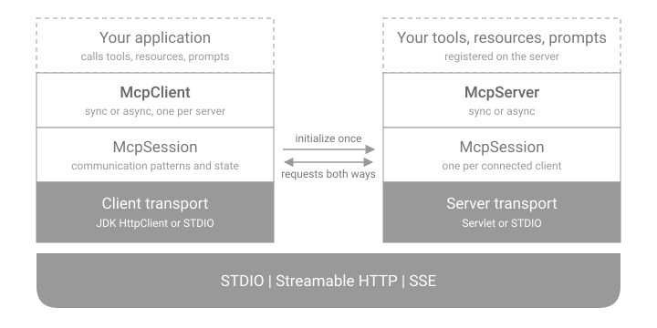
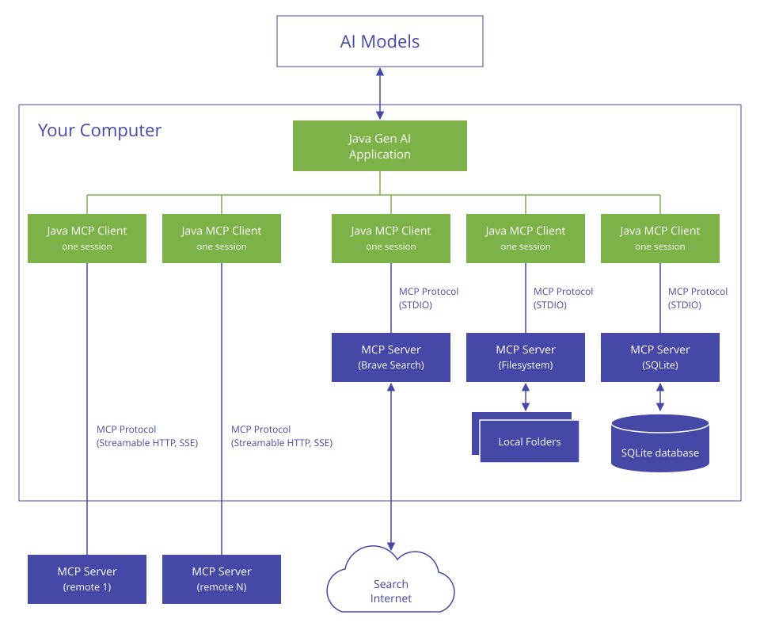
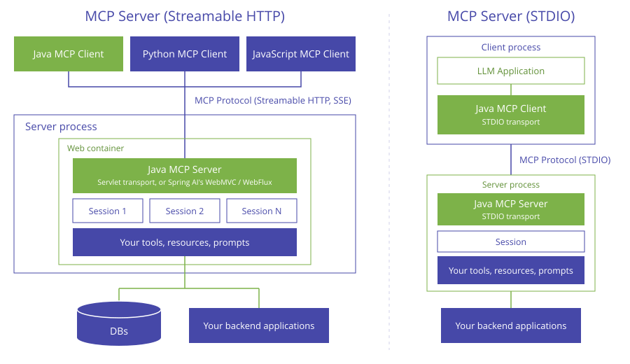
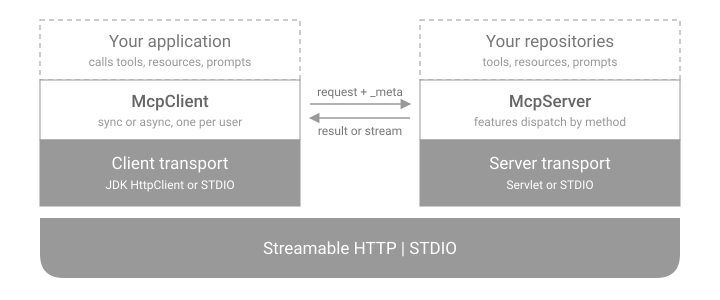
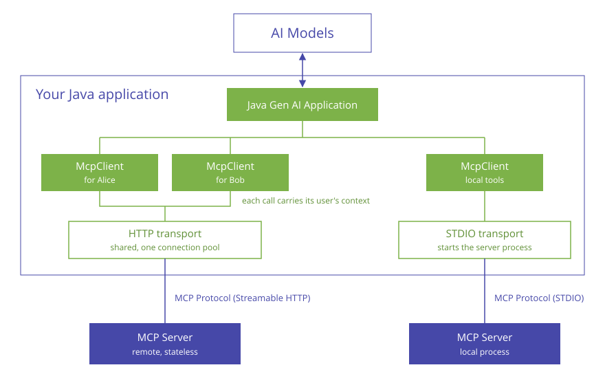
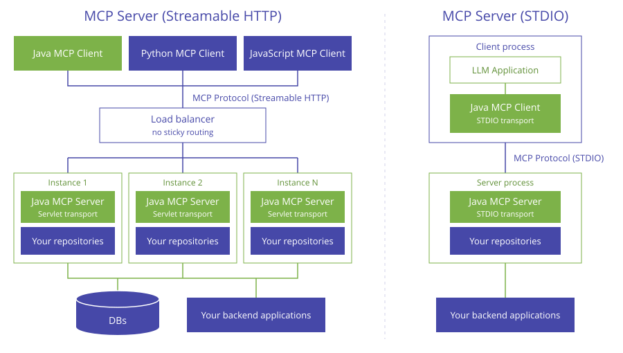

# Overview

The MCP Java SDK lets Java applications act as MCP clients and MCP servers. It requires Java 17 or later.

The SDK contains two implementations of the client and the server, one for each lifecycle model of the protocol:

- **Classic**, for the 2025-11-25 specification and earlier revisions. Client and server set up a session with an `initialize` handshake.
- **Modern**, for the 2026-07-28 specification. There is no handshake and no session; every request stands alone.

Both ship in the same `mcp-core` module, and an application can use both side by side.

## Classic or Modern?

Choose by what the other side speaks. A classic client cannot call a modern server, and a modern client cannot call a classic server.

| | Classic | Modern |
|---|---|---|
| Spec revision | 2025-11-25 and earlier | 2026-07-28 |
| Package | `io.modelcontextprotocol.client`, `io.modelcontextprotocol.server` | `io.modelcontextprotocol.modern` |
| Lifecycle | `initialize` handshake, then a session | None: every request carries the protocol version and capabilities |
| Requests from the server | Sampling, elicitation, roots, ping | None: the server answers "input required" and the client sends the request again |
| Client instances | One per server | One per user, sharing a transport |
| Scaling a server | Sessions live in the server process, except with the stateless server type | Any instance can answer any request |
| Transports | STDIO, Streamable HTTP, SSE (legacy) | STDIO, Streamable HTTP |
| Spring transports | Yes, in [Spring AI](https://docs.spring.io/spring-ai/reference/2.0-SNAPSHOT/api/mcp/mcp-overview.html) 2.0+ | Not yet |
| Guides | [Client](client.md), [Server](server.md) | [Client](client-modern.md), [Server](server-modern.md) |

## Classic Architecture

The classic client and server keep a session between them, set up with an `initialize` handshake:

- **Client/Server Layer (McpClient/McpServer)**: The API you program against, in sync and async variants. McpClient handles the client-side protocol operations and McpServer the server-side ones.
- **Session Layer (McpSession)**: Manages communication patterns and state. It matches requests with responses, in both directions, for as long as the connection lasts.
- **Transport Layer (McpTransport)**: Handles JSON-RPC message serialization and delivery over:
    - STDIO (stdin/stdout)
    - Streamable HTTP (JDK `HttpClient` on the client, Servlet on the server)
    - SSE, the legacy HTTP transport (JDK `HttpClient` on the client, Servlet on the server)
    - Spring WebFlux and Spring WebMVC transports (available in [Spring AI](https://docs.spring.io/spring-ai/reference/2.0-SNAPSHOT/api/mcp/mcp-overview.html) 2.0+)

### Client

An application creates one MCP client per server it uses. Each client holds its own session: to a remote server over Streamable HTTP or SSE, or to a local server process over STDIO.

### Server

A classic MCP server keeps one session per connected client, inside the server process. Over HTTP it runs in a web container. Over STDIO the client starts it as a process of its own.

### Key Interactions

- **Initialization**: Transport setup, protocol compatibility check, capability negotiation, and implementation details exchange.
- **Requests from the client**: Tool discovery and calls, resource discovery and reading, prompts, and completions.
- **Requests from the server**: Sampling, elicitation and roots listing, sent to the client over the same session.
- **Notifications**: List changes, resource updates, progress, and logging.

See [MCP Client](client.md) and [MCP Server](server.md).

## Modern Architecture

The 2026-07-28 revision removes sessions and the `initialize` handshake. The modern client and server are built around that and share no types with the classic ones:

- **Client/Server Layer (McpClient/McpServer)**: The client turns each call into a self-contained request. The server dispatches each request to a feature, which calls a repository you implement.
- **No Session Layer**: Every request carries the protocol version and the client's capabilities in its `_meta`, so any server instance can answer any request.
- **Transport Layer**: Carries one request and its answer, which is a single response or a stream of notifications followed by the response, over:
    - STDIO
    - Streamable HTTP (JDK `HttpClient` on the client, Servlet on the server)

### Client

A modern MCP client stands for one user. An application creates one client per user, and the clients of a server share one transport. Each call carries its user's context to the transport, which adds it to the request.

### Server

A modern MCP server keeps nothing between requests. Over Streamable HTTP, any number of identical instances can serve the same clients without sticky routing. Over STDIO the client starts the server as a process of its own.

### Key Interactions

- **No Initialization**: Building a client does no I/O. The first request goes out when the first call starts.
- **Requests from the client**: Tool discovery and calls, resource discovery and reading, prompts, completions, and `server/discover` for the server's capabilities.
- **Input from the user**: The server cannot send requests to the client. A server that needs input answers with an `input_required` result, and the client sends the request again with the answers.
- **Change notifications**: The client opens a `subscriptions/listen` stream, and the server reports list changes and resource updates on it.

See [MCP Client (2026-07-28)](client-modern.md) and [MCP Server (2026-07-28)](server-modern.md).

## Module Structure

The SDK is organized into modules to separate concerns and allow adopters to bring in only what they need. All of them use the group `io.modelcontextprotocol.sdk`:

| Module | Purpose |
|--------|---------|
| `mcp-bom` | Bill of Materials for dependency management |
| `mcp-core` | The classic and modern clients and servers, with the STDIO, JDK HttpClient and Servlet transports |
| `mcp-json-jackson2` | Jackson 2.x JSON serialization implementation |
| `mcp-json-jackson3` | Jackson 3.x JSON serialization implementation |
| `mcp` | Convenience bundle (`mcp-core` + `mcp-json-jackson3`) |
| `mcp-test` | Shared testing utilities and integration tests |

!!! tip
    A minimal adopter may depend only on `mcp` (core + Jackson 3).

    Spring-based applications that use the classic client or server should use the `mcp-spring-webflux` or `mcp-spring-webmvc` artifacts from [Spring AI](https://docs.spring.io/spring-ai/reference/2.0-SNAPSHOT/api/mcp/mcp-overview.html) 2.0+ (group `org.springframework.ai`), which are no longer part of this SDK.

## Next Steps

-   :rocket:{ .lg .middle } **Quickstart**

    ---

    Get started with dependencies and BOM configuration.

    [:octicons-arrow-right-24: Quickstart](quickstart.md)

-   :fontawesome-brands-github:{ .lg .middle } **GitHub**

    ---

    View the source code and contribute.

    [:octicons-arrow-right-24: Repository](https://github.com/modelcontextprotocol/java-sdk)

-   :material-monitor:{ .lg .middle } **MCP Client (Classic)**

    ---

    Create and configure clients for servers of the 2025-11-25 revision and earlier.

    [:octicons-arrow-right-24: Client](client.md)

-   :material-server:{ .lg .middle } **MCP Server (Classic)**

    ---

    Implement and configure servers for the 2025-11-25 revision and earlier.

    [:octicons-arrow-right-24: Server](server.md)

-   :material-monitor:{ .lg .middle } **MCP Client (Modern)**

    ---

    Call stateless servers of the 2026-07-28 revision.

    [:octicons-arrow-right-24: Client](client-modern.md)

-   :material-server:{ .lg .middle } **MCP Server (Modern)**

    ---

    Build stateless servers for the 2026-07-28 revision.

    [:octicons-arrow-right-24: Server](server-modern.md)

