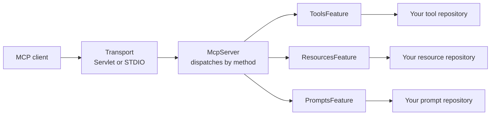
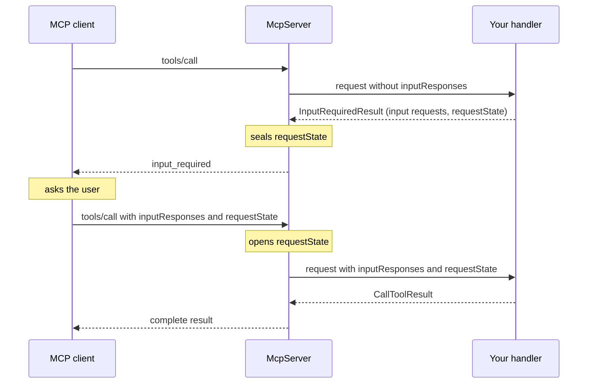

# MCP Server (2026-07-28)

!!! note
    The modern server is available since 2.2.0. Its API, in the `io.modelcontextprotocol.modern` packages,
    may change in minor releases until 3.0, and [some parts of the revision](#not-yet-supported) are not
    implemented. For production servers that talk to today's clients, use the [classic server](server.md).
    To call a modern server from Java, see the [modern client](client-modern.md).

## Overview

The modern server implements the stateless
[2026-07-28 MCP specification revision](https://modelcontextprotocol.io/specification/2026-07-28).
It lives in `io.modelcontextprotocol.modern.server`, next to the classic server, and shares no types with it:
it has its own `McpServer`, its own `McpSchema`, and its own transports. Both ship in `mcp-core`, so no extra
dependency is needed.

The 2026-07-28 revision removes sessions and the `initialize` handshake. Every request carries the protocol
version and client capabilities in its `_meta`, and the server answers each request on its own. The modern
server is built around that:

- **No sessions.** Any instance can serve any request, so a server scales out without sticky routing.
- **No server-to-client requests.** A server that needs input from the user or the model answers with an
  `InputRequiredResult`, and the client retries the request with the answers
  (see [Multi Round-Trip Requests](#multi-round-trip-requests)).
- **Your catalog, your code.** Tools, resources, prompts and completions come from *repositories* you implement,
  not from a registry inside the SDK. Per-tenant, filtered, dynamic and paginated catalogs need no extra API.
- **One server, sync or async.** There is a single `McpServer`. You pick sync or async per repository; sync
  code never sees a Reactor type.
- **Stream only when needed.** A handler returns a single result (sent as `application/json`) or a streaming
  body that can send progress before the result (sent as an SSE stream).

### Classic or modern?

| | [Classic server](server.md) | Modern server |
|---|---|---|
| Package | `io.modelcontextprotocol.server` | `io.modelcontextprotocol.modern.server` |
| Spec revision | 2025-11-25 and earlier | 2026-07-28 |
| Sessions | Yes (except the stateless transport) | No |
| Primitives | Registered specifications | Repositories you implement |
| Server-to-client requests | Sampling, elicitation, roots, ping | Replaced by `InputRequiredResult` |
| Logging | Supported | Not supported (deprecated by the revision) |
By default the modern server only accepts the 2026-07-28 protocol version; change the set with
`supportedVersions(...)` on the builder. A request declaring another version gets an
`Unsupported protocol version` error listing the versions the server supports. Clients that start with an
`initialize` handshake are not supported; serve those with the classic server.

## Quick Start

A server with one tool, served over HTTP:

```java
import java.util.List;
import java.util.Map;

import io.modelcontextprotocol.modern.McpSchema.CallToolResult;
import io.modelcontextprotocol.modern.McpSchema.Implementation;
import io.modelcontextprotocol.modern.McpSchema.TextContent;
import io.modelcontextprotocol.modern.McpSchema.Tool;
import io.modelcontextprotocol.modern.server.McpRequestContext;
import io.modelcontextprotocol.modern.server.McpServer;
import io.modelcontextprotocol.modern.server.McpSyncResponse;
import io.modelcontextprotocol.modern.server.feature.McpSyncTool;
import io.modelcontextprotocol.modern.server.feature.McpSyncToolRepository;
import io.modelcontextprotocol.modern.server.feature.ToolsFeature;
import io.modelcontextprotocol.modern.server.feature.ToolsPage;
import io.modelcontextprotocol.modern.server.transport.HttpServletMcpTransport;

class EchoTools implements McpSyncToolRepository {

    private final McpSyncTool echo = McpSyncTool.of(
            Tool.builder("echo", Map.of(
                    "type", "object",
                    "properties", Map.of("text", Map.of("type", "string")),
                    "required", List.of("text")))
                .description("Echoes the given text")
                .build(),
            (ctx, request) -> McpSyncResponse.result(CallToolResult.builder()
                .addContent(TextContent.builder((String) request.arguments().get("text")).build())
                .build()));

    @Override
    public ToolsPage list(McpRequestContext ctx, String cursor) {
        return ToolsPage.of(List.of(this.echo.definition()));
    }

    @Override
    public McpSyncTool find(McpRequestContext ctx, String name) {
        return "echo".equals(name) ? this.echo : null;
    }

}

McpServer server = McpServer.builder()
    .serverInfo(Implementation.builder("echo-server", "1.0.0").build())
    .feature(ToolsFeature.ofSync(new EchoTools()))
    .build();

HttpServletMcpTransport transport = HttpServletMcpTransport.builder(server)
    .endpoint("/mcp")
    .build();

// Register `transport` as a servlet in your container, mapped to /mcp,
// with async support enabled.
```

`McpServer` is immutable and stateless. `build()` collects the capabilities of the registered features and
serves `server/discover` from them. There is nothing to start; on shutdown, `server.closeGracefully()` ends
open `subscriptions/listen` streams with a `complete` result (see [Change Notifications](#change-notifications)).

Builder options:

| Method | Purpose |
|---|---|
| `serverInfo(Implementation)` | Required. Sent in `_meta` of every result. |
| `instructions(String)` | Instructions for the model, returned by `server/discover`. |
| `feature(McpFeature)` / `features(List)` | Register tools, resources, prompts, completions or a [custom feature](#custom-features). |
| `subscriptions(McpChangePublisher)` | Enable `subscriptions/listen`. See [Change Notifications](#change-notifications). |
| `requestStateCodec(RequestStateCodec)` | Seal `requestState`. See [Securing `requestState`](#securing-requeststate). |
| `discoverCache(long ttlMs, CacheScope)` | Caching hints for `server/discover`. See [Caching](#caching). |
| `supportedVersions(List<String>)` | Protocol versions to accept. Defaults to `2026-07-28`. |
| `jsonMapper(McpJsonMapper)` | JSON mapper. Defaults to `McpJsonDefaults.getMapper()`. |

## Transports

### Streamable HTTP (Servlet)

`HttpServletMcpTransport` is a Jakarta Servlet. It accepts `POST` only, one request or notification per call.
Requests are served on the container thread, so thread-locals set by servlet filters (security context,
tracing) are visible to sync handlers. `subscriptions/listen` streams are served asynchronously, so the servlet
and all filters in front of it must support async requests.

```java
HttpServletMcpTransport transport = HttpServletMcpTransport.builder(server)
    .endpoint("/mcp")
    .contextExtractor(request -> request.getUserPrincipal() == null ? McpTransportContext.EMPTY
            : McpTransportContext.create(Map.of("user", request.getUserPrincipal().getName())))
    .httpHeaderValidator(DefaultServerTransportSecurityValidator.builder()
        .allowedOrigin("https://app.example.com")
        .allowedHost("mcp.example.com")
        .build())
    .keepAliveInterval(Duration.ofSeconds(15))
    .build();
```

| Method | Default | Purpose |
|---|---|---|
| `endpoint(String)` | `/mcp` | The path the transport answers on. |
| `contextExtractor(...)` | empty context | Builds the `McpTransportContext` handlers see. Runs on the container thread before dispatch. |
| `httpHeaderValidator(...)` | rejects any `Origin` | Validates headers before the body is read. See [HTTP Security](#http-security). |
| `maxRequestSize(int)` | 16 MiB | Maximum request body size. |
| `keepAliveInterval(Duration)` | 30 seconds | SSE comment interval on open streams; also detects clients that went away. `null` disables it. |
| `errorStatus(int code, int status)` | see below | HTTP status for a JSON-RPC error code. |

JSON-RPC errors are answered with the HTTP status the specification assigns: `400` for parse errors, invalid
requests, invalid params, header mismatches, missing client capabilities and unsupported protocol versions,
and `404` for unknown methods. Other codes are answered with `200`. Once a stream has started, errors are sent
in-band.

Call `transport.closeGracefully()` on shutdown. It stops accepting requests and also calls
`server.closeGracefully()`, which ends open `subscriptions/listen` streams with a `complete` result.

The servlet requires the routing headers the 2026-07-28 HTTP transport defines, and checks them against the
request body:

- `Mcp-Method` is required on every request and must equal the JSON-RPC method.
- `MCP-Protocol-Version` is required when the body declares a protocol version in `_meta`, and must match it.
- `Mcp-Name` is required on `tools/call` and `prompts/get` (the `name`) and `resources/read` (the `uri`), and
  must match it.

A request with a missing or mismatched header is rejected with error `-32020` (header mismatch, HTTP `400`)
before it is dispatched. Filters can therefore route or authorize on these headers without reading the body.
Keep this in mind when testing with `curl` or another hand-written client.

### STDIO

`StdioMcpTransport` reads one JSON-RPC message per line from stdin and writes responses to stdout. Requests
are handled concurrently, cancellation is supported, and a single writer keeps output lines intact.

```java
StdioMcpTransport transport = new StdioMcpTransport(server, McpJsonDefaults.getMapper());

// Serve until stdin is closed or closeGracefully() is called.
transport.start().block();
```

The transport's threads are daemon threads, so block on `start()` to keep the process alive. Messages longer
than 16M characters are dropped; use the five-argument constructor to change the limit.

Unlike the Servlet transport, `StdioMcpTransport.closeGracefully()` does not call `server.closeGracefully()`:
it cancels in-flight requests, including open `subscriptions/listen` streams, without sending their pending
output. If you use [change notifications](#change-notifications), call `server.closeGracefully()` before
closing the transport.

STDIO has no headers and no `contextExtractor`: handlers always see a transport context without user entries,
so anything that reads identity from `transportContext()`, such as a `requestState`
[principal binding](#securing-requeststate), has nothing to read.

### HTTP Security

Authentication and authorization belong in servlet filters in front of `HttpServletMcpTransport`, including
`401`/`403` challenges. To pass the authenticated identity to handlers, read it in the `contextExtractor` and
put it in the `McpTransportContext`.

Against DNS rebinding, the transport validates headers with a `ServerHttpHeaderValidator` before reading the
body. The default validator has no allowed origins and no allowed hosts, which means:

- A request without an `Origin` header (a non-browser client) passes.
- A request **with** an `Origin` header is rejected with `403`, whether it is cross-origin or same-origin. A
  browser application calling the server must have its origin allowed explicitly.
- The `Host` header is not checked.

Configure `DefaultServerTransportSecurityValidator` with `allowedOrigin(...)` to accept browser clients, and
with `allowedHost(...)` to turn on `Host` validation, as in the example above. See
[HTTP Transport Security](server.md#http-transport-security) for the validator options.

## Features and Repositories

A **feature** serves a set of JSON-RPC methods and contributes capabilities to `server/discover`. The SDK
provides one feature per primitive, each backed by a **repository** you implement:

| Feature | Methods | Sync repository | Async repository |
|---|---|---|---|
| `ToolsFeature` | `tools/list`, `tools/call` | `McpSyncToolRepository` | `McpAsyncToolRepository` |
| `ResourcesFeature` | `resources/list`, `resources/templates/list`, `resources/read` | `McpSyncResourceRepository` | `McpAsyncResourceRepository` |
| `PromptsFeature` | `prompts/list`, `prompts/get` | `McpSyncPromptRepository` | `McpAsyncPromptRepository` |

Each request passes from the transport to the server, which hands it to the feature that serves its method.
The feature calls your repository:



Create a feature with `ofSync(repository)` or `ofAsync(repository)`. Register only the features you need; the
server advertises a capability only when its feature is registered. `completion/complete` has no feature of its
own: the prompts and resources features answer it for their own references, see [Completions](#completions).

Every repository method receives the [`McpRequestContext`](#request-context), so a repository can return a
different catalog per tenant or user. Two rules apply to `list`:

- The order must be deterministic, and the result must not depend on the connection.
- An unrecognized `cursor` must be answered with `McpException.invalidParams(...)`.

To paginate, return a page with a `nextCursor`, for example `new ToolsPage(tools, nextCursor, null, null)`.

### Tools

A repository lists tool definitions and finds a tool by name. `find` returns an `McpSyncTool`, which pairs a
`Tool` definition with its handler, or `null` if there is no such tool (the client then gets an
`Unknown tool` error).

```java
McpSyncTool weather = McpSyncTool.of(
        Tool.builder("get_weather", jsonMapper, """
                {
                  "type": "object",
                  "properties": { "city": { "type": "string" } },
                  "required": ["city"]
                }
                """)
            .outputSchema(jsonMapper, """
                {
                  "type": "object",
                  "properties": { "temperature": { "type": "number" } },
                  "required": ["temperature"]
                }
                """)
            .build(),
        (ctx, request) -> {
            double temperature = weatherService.temperature((String) request.arguments().get("city"));
            return McpSyncResponse.result(CallToolResult.builder()
                .structuredContent(Map.of("temperature", temperature))
                .build());
        });
```

The tools feature validates both directions:

- **Input:** arguments are validated against `inputSchema` before the handler runs. Invalid arguments are
  answered with a `CallToolResult` with `isError: true`, so the model can correct the call.
- **Output:** when the tool declares an `outputSchema`, a successful result must carry `structuredContent` that
  conforms to it. A missing or invalid `structuredContent` is a server bug and is answered with an internal
  error. When a result has `structuredContent` but no `content`, the feature adds its JSON as text content.

To use a different JSON mapper, schema validator or [cache defaults](#caching), use
`ToolsFeature.ofSync(repository, jsonMapper, jsonSchemaValidator, defaultTtlMs, defaultCacheScope)`.

### Resources

A resource repository lists resources and, optionally, resource templates, and finds a resource by URI.
`find` returns an `McpSyncResource` holding the read handler, or `null` if the URI is unknown. Templates are
not matched for you: `find` receives every URI and decides what it serves.

```java
class FileResources implements McpSyncResourceRepository {

    @Override
    public ResourcesPage list(McpRequestContext ctx, String cursor) {
        return ResourcesPage.of(List.of(
                Resource.builder("file:///config.json", "Configuration")
                    .mimeType("application/json")
                    .build()));
    }

    @Override
    public ResourceTemplatesPage listTemplates(McpRequestContext ctx, String cursor) {
        return ResourceTemplatesPage.of(List.of(
                ResourceTemplate.builder("file:///logs/{date}", "Daily log").build()));
    }

    @Override
    public McpSyncResource find(McpRequestContext ctx, String uri) {
        String content = files.read(uri); // null if the URI is unknown
        if (content == null) {
            return null;
        }
        return McpSyncResource.of((c, request) -> McpSyncResponse.result(ReadResourceResult
            .builder(List.of(TextResourceContents.builder(uri, content).build()))
            .build()));
    }

    @Override
    public boolean supportsSubscribe() {
        return true; // see Change Notifications
    }

}
```

`listTemplates`, `findTemplate`, `supportsSubscribe` and `supportsCompletion` have defaults: no templates, no
subscriptions and no completion. `findTemplate` is only needed to [complete](#completions) template variables.
Returning `true`
from `supportsSubscribe` advertises `resources.subscribe` only when the server also has a change publisher
registered with `subscriptions(...)`, because resource updates are only delivered over `subscriptions/listen`.

### Prompts

A prompt repository lists `Prompt` definitions and finds an `McpSyncPrompt` by name, which pairs the definition
with a handler returning a `GetPromptResult`. Required prompt arguments declared in the definition are
checked before the handler runs; a missing one is answered with an invalid-params error.

```java
McpSyncPrompt review = McpSyncPrompt.of(
        Prompt.builder("code_review")
            .description("Review a piece of code")
            .arguments(List.of(PromptArgument.builder("code").required(true).build()))
            .build(),
        (ctx, request) -> McpSyncResponse.result(GetPromptResult
            .builder(List.of(PromptMessage
                .builder(Role.USER, TextContent.builder("Please review:\n" + request.arguments().get("code")).build())
                .build()))
            .build()));
```

### Completions

Completion suggests values for a prompt argument or a resource template variable. The completion handler
belongs to the prompt or template it completes:

```java
McpSyncPrompt review = McpSyncPrompt.of(definition, handler)
    .withCompletionHandler((ctx, request) -> CompleteResult.of(new CompleteResult.Completion(
            languages.stream().filter(l -> l.startsWith(request.argument().value())).toList())));

McpSyncResourceTemplate logs = McpSyncResourceTemplate.of(ResourceTemplate.builder("file:///logs/{date}", "Daily log").build())
    .withCompletionHandler((ctx, request) -> CompleteResult.of(new CompleteResult.Completion(logDates())));
```

A prompt repository returns such a prompt from `find`. A resource repository returns such a template from
`findTemplate(ctx, uriTemplate)`, which is looked up by the exact `uriTemplate` string the client sends in a
`ref/resource` reference. Either repository opts in by returning `true` from `supportsCompletion()`:

```java
class Prompts implements McpSyncPromptRepository {
    // list, find ...

    @Override
    public boolean supportsCompletion() {
        return true;
    }
}
```

The server then serves `completion/complete` and advertises `completions`, sending `ref/prompt` requests to the
prompts feature and `ref/resource` requests to the resources feature. A [custom feature](#custom-features)
completes its own reference types the same way, by returning them from `McpFeature.completionRefTypes()` and
answering `McpFeature.complete(ctx, request)`. Two features completing the same reference type fail the build.

A reference type no feature completes, an unknown prompt or template, or an argument the prompt or template does not declare, is answered with an
invalid-params error. A prompt or template without a completion handler completes to no values. Arguments already
filled in by the user arrive in `request.context()`. At most 100 values are sent; the rest are cut and
`hasMore` is set.

### Sync and Async

Sync and async repositories can be mixed in one server. A sync repository is adapted to the async API inside
the feature; where its code runs depends on the transport:

- `HttpServletMcpTransport` resolves requests in blocking mode, so sync code runs on the container thread.
- Otherwise, sync code runs on Reactor's `boundedElastic` scheduler.

`McpRequestContext.isBlocking()` tells you which applies to the current request.

An async repository returns `Mono`s: `list` returns `Mono<ToolsPage>`, `find` returns `Mono<McpAsyncTool>`
(empty if there is no such tool), and handlers return `Mono<McpAsyncResponse<...>>`.

```java
McpAsyncTool echo = McpAsyncTool.of(echoDefinition,
        (ctx, request) -> Mono.just(McpAsyncResponse.result(CallToolResult.builder()
            .addContent(TextContent.builder((String) request.arguments().get("text")).build())
            .build())));
```

## Request Context

Every repository method and handler receives an `McpRequestContext`, built fresh for each request:

| Method | Returns |
|---|---|
| `method()` | The JSON-RPC method, e.g. `tools/call`. |
| `requestId()` | The JSON-RPC request id. |
| `protocolVersion()` | The protocol version from `_meta`. |
| `clientCapabilities()` | The client capabilities from `_meta`. |
| `clientInfo()` | The client info from `_meta`, if sent. For display and logging only. |
| `progressToken()` | The progress token, or `null`. |
| `meta()` | The raw `_meta` map. |
| `transportContext()` | The `McpTransportContext` built by the Servlet transport's `contextExtractor`. Over STDIO it carries no user entries. |
| `isRetry()` | Whether the request is a [multi round-trip](#multi-round-trip-requests) retry. |
| `isBlocking()` | Whether sync code runs on the calling thread. |

## Streaming Responses

A handler answers with `McpSyncResponse.result(...)` for a single JSON response, or with
`McpSyncResponse.streaming(...)` to send notifications before the result. The streaming body runs once the
transport has opened the response stream and receives an `McpSyncNotifier`:

```java
(ctx, request) -> McpSyncResponse.streaming(notifier -> {
    for (int i = 1; i <= 10; i++) {
        processChunk(i);
        notifier.progress(i * 10, 100.0, "Processed chunk " + i);
    }
    return CallToolResult.builder()
        .addContent(TextContent.builder("Done").build())
        .build();
})
```

`progress` is a no-op when the request carries no progress token, or when the value does not increase.
`notify(method, params)` sends any other request-scoped notification. The async equivalent is
`McpAsyncResponse.streaming(notifier -> ...)` with an `McpAsyncNotifier` whose methods return `Mono<Void>`.

Return a streaming response only when you send notifications; a plain result is cheaper for the client and any
proxies in between.

## Required Client Capabilities

A tool, resource or prompt that only works with clients declaring certain capabilities can say so. The server
rejects calls from other clients with error `-32021` (missing required client capability), listing what is
missing, without running the handler:

```java
ClientCapabilities needsSampling = ClientCapabilities.builder().sampling().build();

McpSyncTool summarize = McpSyncTool.of(summarizeDefinition, needsSampling, handler);
```

`McpSyncResource.of(...)` and `McpSyncPrompt.of(...)` take the same optional argument.

## Multi Round-Trip Requests

The 2026-07-28 revision has no server-to-client requests. Instead, a `tools/call`, `resources/read` or
`prompts/get` handler that needs input answers with an `InputRequiredResult`. It lists the input requests
(elicitation, sampling, roots), each under a key you choose. The client fulfils them and retries the original
request with the answers in `inputResponses`, keyed the same way.



The handler runs once per round and keeps nothing in memory between rounds. Whatever it needs to remember
travels in `requestState` (see [Carrying State Across Rounds](#carrying-state-across-rounds)).

```java
(ctx, request) -> {
    ElicitResult answer = InputResponses.get(
            request.inputResponses(), "user_name", ElicitResult.class, jsonMapper);
    if (answer == null || answer.action() != ElicitResult.Action.ACCEPT) {
        return McpSyncResponse.result(InputRequiredResult.builder()
            .elicit("user_name", ElicitFormRequest.builder("What is your name?", Map.of(
                    "type", "object",
                    "properties", Map.of("name", Map.of("type", "string")),
                    "required", List.of("name")))
                .build())
            .build());
    }
    return McpSyncResponse.result(CallToolResult.builder()
        .addContent(TextContent.builder("Hello, " + answer.content().get("name") + "!").build())
        .build());
}
```

`InputRequiredResult.builder()` offers `elicit(key, ElicitFormRequest)`, `elicitUrl(key, message, url)`,
`createMessage(key, CreateMessageRequest)` and `listRoots(key)`. `InputResponses.get(...)` converts a response
to a type of your choice, such as `ElicitResult`, `CreateMessageResult` or `ListRootsResult`; it returns `null`
when there is no response under the key and answers malformed responses with an invalid-params error.

A handler may only request input the client declared it can provide. Requesting anything else is a server bug
and is answered with an internal error. Either check `ctx.clientCapabilities()` before asking, or declare the
capability as [required](#required-client-capabilities) so that other clients are rejected up front.

### Carrying State Across Rounds

A handler that needs to remember something between rounds puts it in `requestState(String)`. The client
returns it unchanged with the retry, and the handler reads it from `request.requestState()`:

```java
return McpSyncResponse.result(InputRequiredResult.builder()
    .elicit("step2", ElicitFormRequest.builder("What is your favorite color?", colorSchema).build())
    .requestState("round-2:" + name)
    .build());
```

### Securing `requestState`

The server seals `requestState` before sending it and opens it on retry, so handlers only ever see state they
issued themselves. A tampered, expired or misdirected state is rejected with an invalid-params error before
the handler runs.

The default `HmacRequestStateCodec` signs the state with HMAC-SHA256 and binds it to an expiry (10 minutes by
default), to the method and tool, resource or prompt name, and optionally to a principal. Without a configured
key it generates a random key per process, and logs a warning. That works for a single instance; with more than
one instance, configure a shared key so that any instance can open state sealed by another:

```java
McpServer server = McpServer.builder()
    .serverInfo(serverInfo)
    .feature(ToolsFeature.ofSync(tools))
    .requestStateCodec(HmacRequestStateCodec.builder()
        .key(sharedSecret) // byte[], at least 32 bytes recommended
        .ttl(Duration.ofMinutes(5))
        .principalExtractor(transportContext -> (String) transportContext.get("user"))
        .build())
    .build();
```

The principal binding only applies when the transport puts an identity in the transport context; over STDIO
the extractor above always returns `null`, so state is not bound to a user.

Sealing bounds the replay window but does not make the state single-use. Where that matters, enforce it in your
handler. To use another scheme, implement `RequestStateCodec`.

Results of retried requests are marked as not cacheable.

## Change Notifications

Clients learn about catalog changes through `subscriptions/listen`, a long-lived stream that the server feeds
from an `McpChangePublisher`. `McpChangeFeed` is a ready-made in-memory publisher; register it with
`subscriptions(...)` and call `broadcast(...)` when something changes:

```java
McpChangeFeed changes = new McpChangeFeed();

McpServer server = McpServer.builder()
    .serverInfo(serverInfo)
    .feature(ToolsFeature.ofSync(tools))
    .feature(ResourcesFeature.ofSync(resources))
    .subscriptions(changes)
    .build();

// Later, when the catalog changes:
changes.broadcast(new ServerChange.ToolsListChanged());
changes.broadcast(new ServerChange.ResourceUpdated("file:///config.json"));
```

The core change types are `ToolsListChanged`, `PromptsListChanged`, `ResourcesListChanged` and
`ResourceUpdated(uri)`; a [custom feature](#custom-features) may define its own. Each is forwarded only if the
matching feature is registered; `ResourceUpdated` also requires the resource repository's
`supportsSubscribe()` to return `true`. Changes broadcast while no client is listening are dropped.

`McpChangeFeed` only reaches listeners connected to the same instance. With several instances, implement
`McpChangePublisher` over a shared message bus so that every instance sees every change.

## Caching

The 2026-07-28 revision lets list results, `resources/read` results and `server/discover` carry caching
hints: `ttlMs` and a `cacheScope` of `PUBLIC` or `PRIVATE`. By default the server sends `ttlMs: 0` with
`PRIVATE`, meaning "do not cache".

- Set defaults for a feature with its full factory, for example
  `PromptsFeature.ofSync(repository, jsonMapper, 60_000, CacheScope.PRIVATE)`.
- Override them per page through the `ttlMs` and `cacheScope` fields of `ToolsPage`, `ResourcesPage`,
  `ResourceTemplatesPage` or `PromptsPage`. Every page of one listing must use the same `cacheScope`.
- Set hints for a resource read on the result itself, with `ReadResourceResult.builder(...).ttlMs(...)` and
  `.cacheScope(...)`. The feature defaults apply to list results only.
- Set hints for `server/discover` with `McpServer.builder().discoverCache(ttlMs, cacheScope)`.

Use `PUBLIC` only for results that contain nothing user-specific; a shared cache may serve them to any user.

## Custom Headers (SEP-2243)

A tool can ask clients to mirror selected arguments into HTTP headers, so that gateways and filters can route or
authorize on them without parsing the body. Mark the argument in the input schema with `x-mcp-header`:

```json
{
  "type": "object",
  "properties": {
    "region": { "type": "string", "x-mcp-header": "Region" }
  }
}
```

A client calling this tool over HTTP sends `Mcp-Param-Region` with the value of `region`. The tools feature
checks the header against the argument and rejects a mismatch with error `-32020` (header mismatch, HTTP `400`)
before input-schema validation. Annotations that are not valid are logged as a warning and not enforced;
compliant clients drop such tools from their listing. Over STDIO there are no headers, and the check is skipped.

## Custom Features

`McpFeature` is the extension point the built-in features use, and it is open to you. A feature declares the
methods it serves, handles them, and can contribute capabilities and opt methods into multi round-trip
requests:

```java
class EchoFeature implements McpFeature {

    @Override
    public Set<String> methods() {
        return Set.of("example/echo");
    }

    @Override
    public Mono<? extends McpAsyncResponse<? extends Result>> handle(McpRequestContext ctx, Object params) {
        // EchoResult is your own type implementing McpSchema.Result
        return Mono.just(McpAsyncResponse.result(new EchoResult(params)));
    }

    @Override
    public void capabilities(ServerCapabilities.Builder builder) {
        // Optional: advertise what this feature adds in server/discover
    }

}
```

Each method may be served by one feature only; `build()` fails on duplicates. `server/discover` and
`subscriptions/listen` are provided by the server. A result must have a non-empty `resultType`; one without is
answered with an internal error.

Methods listed in `inputRequiredMethods()` may answer with an `InputRequiredResult`. On retry, the server opens
and verifies their `requestState` before calling the handler, which receives the original, unsealed value.
For methods **not** listed, the server does not touch `requestState`: a handler that reads it gets whatever the
client sent, unverified. List every method that relies on `requestState`.

A feature can also add its own fields to the `subscriptions/listen` filter, as an extension such as Tasks adds
`taskIds`. The filter (`McpSchema.SubscriptionFilter`) is an open JSON object, so such fields reach the server
as the client sent them. `honouredSubscriptions(ctx, requested)` returns the part of them the feature agrees to
honour: the server acknowledges it next to the core fields, and leaves out any field no feature honours. To
reject the request instead, for example because the client didn't declare the extension, throw an
`McpException`; it is the answer to the listen request, and no stream opens.

The feature then publishes its changes through the server's `McpChangePublisher` as its own `ServerChange`. A
change names its notification method and params and decides which honoured filters cover it; the server adds the
stream's `io.modelcontextprotocol/subscriptionId` to the notification's `_meta`:

```java
record TaskChanged(String taskId) implements ServerChange {

    @Override
    public String method() {
        return "notifications/tasks";
    }

    @Override
    public Object params() {
        return Map.of("taskId", taskId);
    }

    @Override
    public boolean isHonouredBy(SubscriptionFilter honoured) {
        return honoured.get("taskIds") instanceof List<?> ids && ids.contains(taskId);
    }

}
```

## Error Handling

- Throw (or, in async code, signal) an `McpException` to answer with a JSON-RPC error. Its code, message and
  data are sent to the client as given. `McpException.invalidParams(...)` covers the common case.
- Any other exception is treated as a bug: it is logged, and the client gets a generic `Internal error`, so
  exception messages that may expose internals stay on the server.
- For tool failures the model should see and react to, return a `CallToolResult` with `isError(true)` instead
  of throwing. See [Error Handling](server.md#error-handling) for the distinction between the two tiers.

## Not Yet Supported

- Tasks.
- Logging, which the 2026-07-28 revision deprecates. The modern server never sends log messages.
- Spring WebMVC and WebFlux transports. Spring AI's transports target the classic server.

For a larger working example, see the
[modern conformance server](https://github.com/modelcontextprotocol/java-sdk/tree/main/conformance-tests/server-servlet-modern),
which passes all required 2026-07-28 conformance scenarios. It covers the Servlet transport, tools, resources,
prompts, completions, streaming, required capabilities, multi round-trip requests and change notifications.
